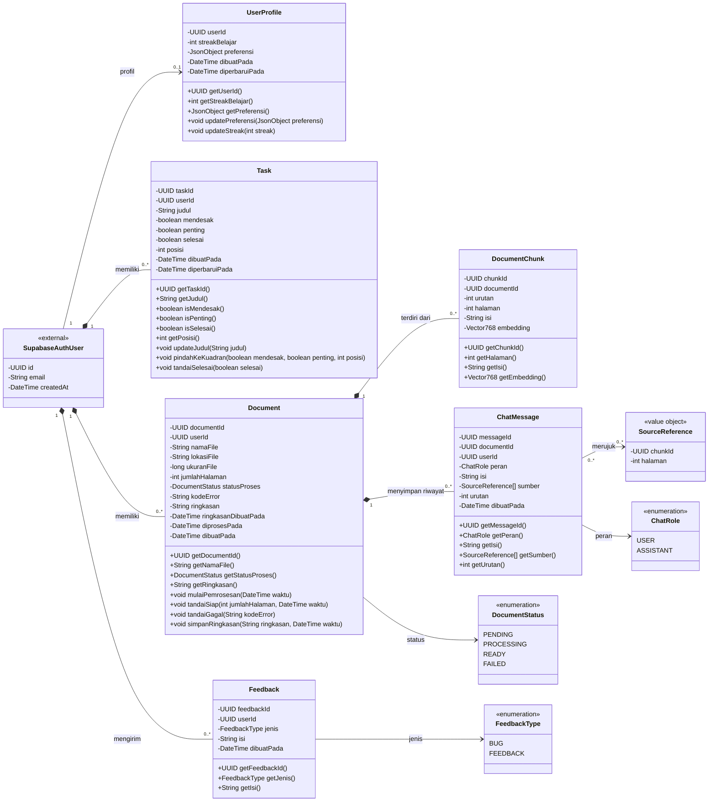
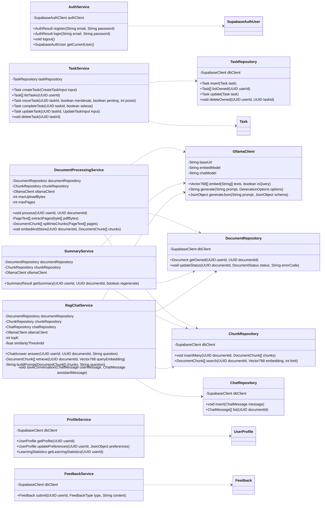
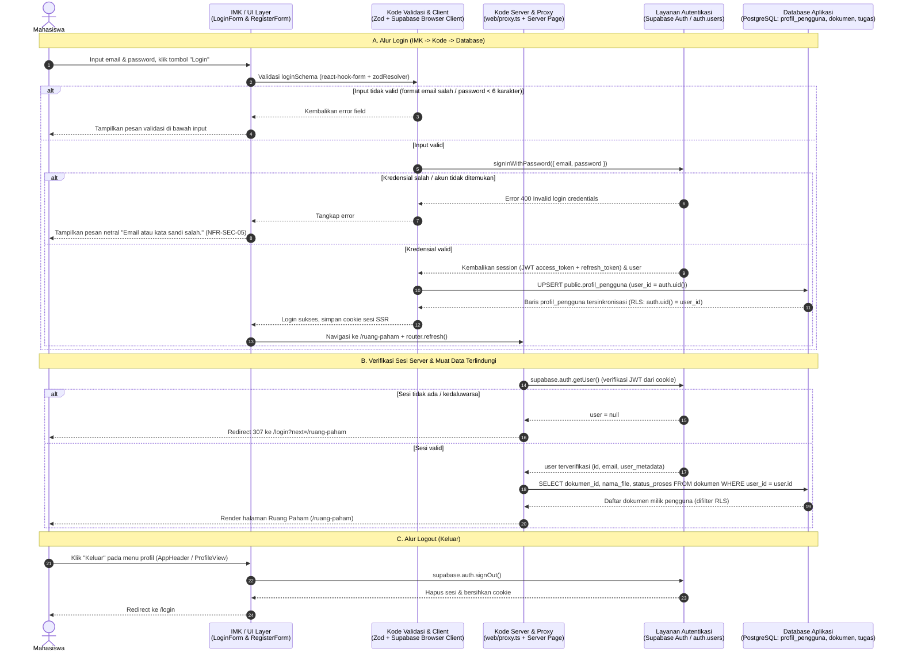

# LAPORAN TUGAS KELOMPOK

# ANALISIS DAN PERANCANGAN PERANGKAT LUNAK

# CLASS DIAGRAM APLIKASI PAHAMIN

Model kelas domain dan layanan, evaluasi kelengkapan dan kenormalan, serta kerangka kode

## Disusun oleh Kelompok INTERCORP

1. Andi Athallah Radja Maliq Muhammad — 103072400034
2. Krisna Putra Wicaksana — 103072400079
3. Calvin Immanuel Lado — 103072400158
4. Hierelda Talahatu — 103072400028

# PROGRAM STUDI S1 INFORMATIKA

# DIREKTORAT KAMPUS SURABAYA

# UNIVERSITAS TELKOM

**2026**

# DAFTAR ISI

1. [Tujuan dan ruang lingkup](#1-tujuan-dan-ruang-lingkup)
2. [Entitas dan tanggung jawab kelas](#2-entitas-dan-tanggung-jawab-kelas)
3. [Class diagram domain](#3-class-diagram-domain)
4. [Class diagram layanan](#4-class-diagram-layanan)
5. [Evaluasi kelengkapan class diagram](#5-evaluasi-kelengkapan-class-diagram)
6. [Evaluasi kenormalan model data](#6-evaluasi-kenormalan-model-data)
7. [Kerangka kode implementasi](#7-kerangka-kode-implementasi)
8. [Rencana integrasi login](#8-rencana-integrasi-login)
9. [Sumber acuan](#9-sumber-acuan)

---

# 1. Tujuan dan ruang lingkup

Laporan ini menyajikan class diagram PahaMIn berdasarkan model data dan rancangan layanan pada SKPL/DPPL v1.3. Tujuannya adalah memperlihatkan kelas yang dikelola aplikasi, relasi antarkelas, multiplicity, atribut beserta tipe dan visibility, serta operasi yang disediakan kelas.

PahaMIn membantu mahasiswa mengelola prioritas tugas dengan Matriks Eisenhower dan memahami materi PDF melalui Ruang Paham berbasis RAG. Model mengikuti enam entitas aplikasi yang telah dirancang. Identitas akun dimiliki Supabase Auth; kelas layanan autentikasi ditampilkan sebagai integrasi eksternal.

Dokumen ini juga menilai kelengkapan diagram dan normalisasi model relasional, serta menyediakan kerangka deklarasi kode tanpa isi logika method. Status repo dan langkah integrasi login dijelaskan sebagai rencana; laporan ini tidak mengimplementasikan atau menjalankan alur login.

## 1.1 Ruang lingkup dan notasi

Model mencakup identitas pengguna dari Supabase Auth, enam entitas data aplikasi, layanan autentikasi, tugas, dokumen, ringkasan, chat, profil, feedback, serta layanan backend RAG yang sudah dijelaskan DPPL. Kelas antarmuka seperti halaman login dan komponen UI tidak dimasukkan sebagai kelas domain karena merupakan komponen presentasi.

Notasi visibilitas UML:

- `+` publik: dapat dipanggil oleh lapisan lain melalui kontrak kelas.
- `-` privat: detail internal kelas, termasuk atribut domain.
- `#` terlindungi: untuk pewarisan bila diperlukan.
- `~` package: hanya untuk kelas dalam paket yang sama.

Tipe `UUID`, `DateTime`, `JsonObject`, dan `Vector768` adalah alias konseptual. Pada PostgreSQL, representasinya masing-masing `uuid`, `timestamptz`, `jsonb`, dan `vector(768)`.

## 1.2 Batas model

Diagram memisahkan kelas data domain dari kelas layanan dan tidak memasukkan halaman login atau komponen UI sebagai kelas domain. `auth.users` tetap diperlakukan sebagai layanan identitas eksternal, bukan tabel aplikasi.

# 2. Entitas dan tanggung jawab kelas

Enam kelas aplikasi bersesuaian dengan enam tabel pada ERD DPPL. Operasi kelas menjelaskan perilaku domain atau layanan; operasi tersebut tidak berarti setiap method harus menjadi kolom atau fungsi database.

| Kelas | Tanggung jawab | Persistensi |
|---|---|---|
| `SupabaseAuthUser` | Identitas dan email akun yang dikelola layanan autentikasi. | `auth.users` milik Supabase |
| `UserProfile` | Preferensi dan cache streak belajar per pengguna. | `profil_pengguna` |
| `Task` | Kartu tugas, klasifikasi Eisenhower, posisi, dan status selesai. | `tugas` |
| `Document` | Metadata PDF, status pemrosesan, dan ringkasan. | `dokumen` |
| `DocumentChunk` | Potongan teks, halaman sumber, dan embedding. | `potongan_dokumen` |
| `ChatMessage` | Pertanyaan/jawaban per dokumen, urutan, dan rujukan sumber. | `pesan_chat` |
| `Feedback` | Laporan bug atau masukan pengguna. | `umpan_balik` |

# 3. Class diagram domain



`SupabaseAuthUser` adalah kelas eksternal yang dikelola Supabase Auth, bukan tabel buatan aplikasi. Relasi profil ditulis `0..1` untuk mengakomodasi masa pembuatan/backfill profil; DPPL menetapkan trigger untuk membuat profil saat akun baru terdaftar. Tugas, dokumen, dan feedback mengikuti kepemilikan pengguna. Potongan dan pesan mengikuti siklus hidup dokumen, sesuai kebijakan cascade pada DPPL.

`SourceReference` adalah objek nilai yang disimpan dalam `pesan_chat.sumber` sebagai JSONB. Rujukan potongan tidak dimodelkan sebagai FK relasional langsung; validasi konsistensinya berada pada aturan database/layanan yang didokumentasikan DPPL.

# 4. Class diagram layanan

Diagram ini memperluas diagram layanan backend yang telah ada di DPPL dengan layanan web untuk alur tugas, profil, feedback, dan login. Ini adalah pembagian tanggung jawab logis, bukan klaim bahwa semua kelas layanan sudah tersedia dalam kode.



Operasi CRUD dokumen, profil, dan feedback dapat dipanggil dari Next.js ke Supabase sesuai DPPL. Pemrosesan PDF, embedding, ringkasan, dan RAG tetap melalui FastAPI. Validasi otorisasi pemilik harus dilakukan pada setiap layanan yang menangani data pengguna.

# 5. Evaluasi kelengkapan class diagram

| Aspek | Hasil evaluasi | Tindak lanjut |
|---|---|---|
| Cakupan objek domain | Lengkap untuk enam entitas persistensi PahaMIn v1.3 serta identitas Supabase Auth eksternal. | Pertahankan batas ini; jangan membuat kelas kuadran terpisah karena kuadran dihitung dari `mendesak` dan `penting`. |
| Atribut dan tipe | Atribut utama telah dipetakan dari kamus data DPPL; tipe UML diberi representasi yang sesuai dengan tipe SQL. | Pastikan perubahan schema tercermin di diagram dan kode. |
| Access modifier atribut | Atribut domain menggunakan `-` (private) agar perubahan dilakukan melalui operasi kelas. | Jangan membuka atribut langsung; validasi input pada service/API dan database. |
| Operasi dan access modifier | Operasi domain/service yang terlihat oleh pemanggil menggunakan `+`; operasi internal layanan menggunakan `-`. | Tambahkan operasi hanya ketika use case atau kebutuhan arsitektur membutuhkannya. |
| Relasi dan multiplicity | Relasi pemilik, dokumen-potongan, serta dokumen-pesan ditampilkan dengan jumlah objek. | Tinjau multiplicity profil bila semua akun lama sudah dijamin memiliki profil. |
| Relasi siklus hidup | Komposisi dipakai pada data turunan yang dihapus bersama pemilik/induk sesuai cascade dan keputusan retensi. | File Storage tetap memerlukan aksi penghapusan di service; komposisi database saja tidak menghapus objek Storage. |
| Enum dan nilai terbatas | Status dokumen, peran pesan, dan jenis feedback dimodelkan sebagai enumeration. | Samakan nilai enum aplikasi dengan constraint SQL dan payload API. |
| Batas lapisan | Kelas domain dipisahkan dari layanan dan repository; autentikasi eksternal diberi label. | Jangan mencampur komponen UI, ORM, dan entitas domain dalam satu kelas besar. |
| Fitur autentikasi | Alur login/register/logout tercakup melalui `AuthService`, tetapi belum merupakan bukti bahwa UI dan sesi telah berjalan. | Implementasikan dan verifikasi jalur UI–Supabase Auth–cookie/session–proteksi route. |

# 6. Evaluasi kenormalan model data

Evaluasi normalisasi pada bagian ini diterapkan terhadap skema relasional basis data yang dirancang dalam DPPL dan direalisasikan melalui SQL. Evaluasi tersebut meninjau struktur atribut dan relasi antartabel, sedangkan class diagram UML digunakan untuk menggambarkan struktur kelas, atribut, operasi, serta hubungan antarkelas.

## 6.1 Bentuk Normal Pertama (1NF)

Kolom biasa menyimpan nilai bertipe tunggal. Ada dua pengecualian semi-terstruktur yang disengaja: `profil_pengguna.preferensi` menyimpan sekumpulan preferensi dalam JSONB dan `pesan_chat.sumber` menyimpan daftar rujukan sumber dalam JSONB. Jika setiap preferensi atau rujukan perlu dicari, dihubungkan dengan FK, atau dikelola sebagai baris mandiri, pisahkan menjadi tabel anak. Untuk kebutuhan saat ini, JSONB mengurangi perubahan schema dan integritas rujukan sumber ditangani oleh validasi tambahan.

## 6.2 Bentuk Normal Kedua (2NF)

Setiap tabel menggunakan primary key satu kolom. Atribut non-key bergantung pada seluruh primary key, sehingga tidak tampak ketergantungan parsial. Constraint unik seperti `(dokumen_id, urutan)` mengatur identitas urutan tanpa mengubah PK utama.

## 6.3 Bentuk Normal Ketiga (3NF)

Data tugas, dokumen, potongan, chat, dan feedback dipisah menurut entitas sehingga tidak terlihat ketergantungan transitif umum di antara atribut non-key. `pesan_chat.user_id` mengulang pemilik yang dapat diturunkan dari `dokumen_id`; pasangan FK `(dokumen_id, user_id)` sengaja menjaga agar pesan hanya terkait dengan dokumen milik pengguna yang sama dan mempermudah kebijakan akses.

`profil_pengguna.streak_belajar` adalah cache yang dihitung dari aktivitas chat, dan `dokumen.ringkasan` adalah hasil turunan yang disimpan agar mudah ditampilkan kembali. Keduanya merupakan denormalisasi yang disengaja demi performa/kemudahan; pembaruannya harus tetap sinkron dengan sumber data. Kuadran tugas tidak disimpan sebagai kolom terpisah karena dapat dihitung dari `mendesak` dan `penting`, sehingga tidak ada duplikasi nilai kuadran.

## 6.4 Kesimpulan normalisasi

Model relasional inti secara umum memenuhi 2NF dan 3NF dengan beberapa pilihan semi-terstruktur atau cache yang disengaja. Untuk mendekati 1NF secara ketat dan menguatkan integritas referensial, opsi lanjutan adalah membuat tabel `preferensi_pengguna` dan `sumber_pesan`; perubahan tersebut tidak wajib selama JSONB tetap tervalidasi dan kebutuhan query tidak memerlukan relasi per item.

## 7. Kerangka kode implementasi

Kerangka ini menggambarkan model domain frontend. Method sengaja hanya berupa deklarasi abstrak agar kontrak dan visibility terlihat tanpa mengisi logika method. Alias waktu harus disamakan dengan bentuk serialisasi yang dipilih aplikasi.

```typescript
export type UUID = string;
export type DateTime = string;
export type JsonObject = Record<string, unknown>;
export type Vector768 = readonly number[];

export type DocumentStatus = "PENDING" | "PROCESSING" | "READY" | "FAILED";
export type ChatRole = "user" | "assistant";
export type FeedbackType = "bug" | "feedback";

export interface SourceReference {
  chunkId: UUID;
  halaman: number;
}

export abstract class UserProfile {
  constructor(
    private readonly userId: UUID,
    private streakBelajar: number,
    private preferensi: JsonObject,
    private readonly dibuatPada: DateTime,
    private diperbaruiPada: DateTime,
  ) {}

  public abstract getUserId(): UUID;
  public abstract getStreakBelajar(): number;
  public abstract getPreferensi(): JsonObject;
  public abstract updatePreferensi(preferensi: JsonObject): void;
  public abstract updateStreak(streak: number): void;
}

export abstract class Task {
  constructor(
    private readonly taskId: UUID,
    private readonly userId: UUID,
    private judul: string,
    private mendesak: boolean,
    private penting: boolean,
    private selesai: boolean,
    private posisi: number,
    private readonly dibuatPada: DateTime,
    private diperbaruiPada: DateTime,
  ) {}

  public abstract getTaskId(): UUID;
  public abstract getJudul(): string;
  public abstract isMendesak(): boolean;
  public abstract isPenting(): boolean;
  public abstract isSelesai(): boolean;
  public abstract getPosisi(): number;
  public abstract updateJudul(judul: string): void;
  public abstract pindahKeKuadran(mendesak: boolean, penting: boolean, posisi: number): void;
  public abstract tandaiSelesai(selesai: boolean): void;
}

export abstract class Document {
  constructor(
    private readonly documentId: UUID,
    private readonly userId: UUID,
    private readonly namaFile: string,
    private readonly lokasiFile: string,
    private readonly ukuranFile: number,
    private jumlahHalaman: number | null,
    private statusProses: DocumentStatus,
    private kodeError: string | null,
    private ringkasan: string | null,
    private ringkasanDibuatPada: DateTime | null,
    private diprosesPada: DateTime | null,
    private readonly dibuatPada: DateTime,
  ) {}

  public abstract getDocumentId(): UUID;
  public abstract getNamaFile(): string;
  public abstract getStatusProses(): DocumentStatus;
  public abstract getRingkasan(): string | null;
  public abstract mulaiPemrosesan(waktu: DateTime): void;
  public abstract tandaiSiap(jumlahHalaman: number, waktu: DateTime): void;
  public abstract tandaiGagal(kodeError: string): void;
  public abstract simpanRingkasan(ringkasan: string, waktu: DateTime): void;
}

export abstract class DocumentChunk {
  constructor(
    private readonly chunkId: UUID,
    private readonly documentId: UUID,
    private readonly urutan: number,
    private readonly halaman: number,
    private readonly isi: string,
    private readonly embedding: Vector768,
  ) {}

  public abstract getChunkId(): UUID;
  public abstract getHalaman(): number;
  public abstract getIsi(): string;
  public abstract getEmbedding(): Vector768;
}

export abstract class ChatMessage {
  constructor(
    private readonly messageId: UUID,
    private readonly documentId: UUID,
    private readonly userId: UUID,
    private readonly peran: ChatRole,
    private readonly isi: string,
    private readonly sumber: readonly SourceReference[] | null,
    private readonly urutan: number,
    private readonly dibuatPada: DateTime,
  ) {}

  public abstract getMessageId(): UUID;
  public abstract getPeran(): ChatRole;
  public abstract getIsi(): string;
  public abstract getSumber(): readonly SourceReference[] | null;
  public abstract getUrutan(): number;
}

export abstract class Feedback {
  constructor(
    private readonly feedbackId: UUID,
    private readonly userId: UUID,
    private readonly jenis: FeedbackType,
    private readonly isi: string,
    private readonly dibuatPada: DateTime,
  ) {}

  public abstract getFeedbackId(): UUID;
  public abstract getJenis(): FeedbackType;
  public abstract getIsi(): string;
}

export interface CreateTaskInput {
  judul: string;
  mendesak: boolean;
  penting: boolean;
}

export interface UpdateTaskInput {
  judul?: string;
  mendesak?: boolean;
  penting?: boolean;
}

export interface PageText {
  halaman: number;
  isi: string;
}

export interface SummaryResult {
  summary: string;
  keyPoints: readonly string[];
  generatedAt: DateTime;
  cached: boolean;
}

export interface ChatAnswer {
  status: "success" | "insufficient_context";
  answer: string;
  sources: readonly SourceReference[];
}

export interface LearningStatistics {
  readyDocumentCount: number;
  chatQuestionCount: number;
  streakBelajar: number;
}

export interface GenerationOptions {
  temperature: number;
  numCtx: number;
}

export abstract class OllamaClient {
  constructor(
    private readonly baseUrl: string,
    private readonly embedModel: string,
    private readonly chatModel: string,
  ) {}

  public abstract embed(texts: readonly string[], isQuery: boolean): Promise<readonly Vector768[]>;
  public abstract generate(prompt: string, options: GenerationOptions): Promise<string>;
  public abstract generateJson(prompt: string, schema: JsonObject): Promise<JsonObject>;
}

export abstract class DocumentRepository {
  constructor(private readonly dbClient: unknown) {}

  public abstract getOwned(userId: UUID, documentId: UUID): Promise<Document>;
  public abstract updateStatus(
    documentId: UUID,
    status: DocumentStatus,
    errorCode: string | null,
  ): Promise<void>;
}

export abstract class TaskRepository {
  constructor(private readonly dbClient: unknown) {}

  public abstract insert(task: Task): Promise<Task>;
  public abstract listOwned(userId: UUID): Promise<readonly Task[]>;
  public abstract update(task: Task): Promise<Task>;
  public abstract deleteOwned(userId: UUID, taskId: UUID): Promise<void>;
}

export abstract class ChunkRepository {
  constructor(private readonly dbClient: unknown) {}

  public abstract insertMany(documentId: UUID, chunks: readonly DocumentChunk[]): Promise<void>;
  public abstract search(
    documentId: UUID,
    embedding: Vector768,
    limit: number,
  ): Promise<readonly DocumentChunk[]>;
}

export abstract class ChatRepository {
  constructor(private readonly dbClient: unknown) {}

  public abstract insert(message: ChatMessage): Promise<void>;
  public abstract list(documentId: UUID): Promise<readonly ChatMessage[]>;
}

export abstract class AuthService {
  constructor(private readonly authClient: unknown) {}

  public abstract register(email: string, password: string): Promise<UUID>;
  public abstract login(email: string, password: string): Promise<UUID>;
  public abstract logout(): Promise<void>;
  public abstract getCurrentUser(): Promise<UUID | null>;
}

export abstract class TaskService {
  constructor(private readonly taskRepository: TaskRepository) {}

  public abstract createTask(input: CreateTaskInput): Promise<Task>;
  public abstract listTasks(userId: UUID): Promise<readonly Task[]>;
  public abstract moveTask(
    taskId: UUID,
    mendesak: boolean,
    penting: boolean,
    posisi: number,
  ): Promise<Task>;
  public abstract completeTask(taskId: UUID, selesai: boolean): Promise<Task>;
  public abstract updateTask(taskId: UUID, input: UpdateTaskInput): Promise<Task>;
  public abstract deleteTask(taskId: UUID): Promise<void>;
}

export abstract class DocumentProcessingService {
  constructor(
    private readonly documentRepository: DocumentRepository,
    private readonly chunkRepository: ChunkRepository,
    private readonly ollamaClient: OllamaClient,
    private readonly maxUploadBytes: number,
    private readonly maxPages: number,
  ) {}

  public abstract process(userId: UUID, documentId: UUID): Promise<void>;
  protected abstract extractPages(pdfBytes: Uint8Array): readonly PageText[];
  protected abstract splitIntoChunks(pages: readonly PageText[]): readonly DocumentChunk[];
  protected abstract embedAndStore(
    documentId: UUID,
    chunks: readonly DocumentChunk[],
  ): Promise<void>;
}

export abstract class SummaryService {
  constructor(
    private readonly documentRepository: DocumentRepository,
    private readonly chunkRepository: ChunkRepository,
    private readonly ollamaClient: OllamaClient,
  ) {}

  public abstract getSummary(
    userId: UUID,
    documentId: UUID,
    regenerate: boolean,
  ): Promise<SummaryResult>;
}

export abstract class RagChatService {
  constructor(
    private readonly documentRepository: DocumentRepository,
    private readonly chunkRepository: ChunkRepository,
    private readonly chatRepository: ChatRepository,
    private readonly ollamaClient: OllamaClient,
    private readonly topK: number,
    private readonly similarityThreshold: number,
  ) {}

  public abstract answer(userId: UUID, documentId: UUID, question: string): Promise<ChatAnswer>;
  protected abstract retrieve(
    documentId: UUID,
    queryEmbedding: Vector768,
  ): Promise<readonly DocumentChunk[]>;
  protected abstract buildPrompt(chunks: readonly DocumentChunk[], question: string): string;
  protected abstract saveConversation(
    userMessage: ChatMessage,
    assistantMessage: ChatMessage,
  ): Promise<void>;
}

export abstract class ProfileService {
  constructor(private readonly dbClient: unknown) {}

  public abstract getProfile(userId: UUID): Promise<UserProfile>;
  public abstract updatePreferences(userId: UUID, preferences: JsonObject): Promise<UserProfile>;
  public abstract getLearningStatistics(userId: UUID): Promise<LearningStatistics>;
}

export abstract class FeedbackService {
  constructor(private readonly dbClient: unknown) {}

  public abstract submit(userId: UUID, type: FeedbackType, content: string): Promise<Feedback>;
}
```

Kelas domain dan signature di atas belum mengimplementasikan validasi, persistence, atau aturan bisnis. Implementasi kelak harus menggunakan pola validasi frontend proyek dan kontrak Supabase/FastAPI; tipe data dan aturan tabel tetap diverifikasi pada batas backend/database.

# 8. Implementasi dan integrasi alur login (IMK – kode – database)

Alur autentikasi PahaMIn telah diimplementasikan secara menyeluruh menghubungkan lapisan antarmuka pengguna (IMK), kode aplikasi Next.js App Router, dan database Supabase (`auth.users` serta 6 tabel domain `public`):

1. **Lapisan IMK / Antarmuka (`web/app/login/page.tsx`, `web/app/register/page.tsx`, `web/components/auth/`):**
   - Mengikuti acuan visual ekspor Figma (`LOGIN.png`, `SIGN IN.png`) dan komponen dari prototipe `PahamIn_Developers` berupa kartu modal autentikasi di atas latar belakang *shell* Ruang Paham yang diburamkan (`AuthShellBackdrop`).
   - Memakai validasi `react-hook-form` + `zodResolver` (`web/lib/schemas/auth.ts`) dengan pesan gagal masuk yang netral (`"Email atau kata sandi salah."`) sesuai `NFR-SEC-05` agar tidak membocorkan keberadaan email pengguna.
2. **Lapisan Kode & Proteksi Sesi (`web/proxy.ts`, `web/lib/supabase/client.ts`, `web/lib/supabase/server.ts`):**
   - Form `LoginForm` memanggil `supabase.auth.signInWithPassword({ email, password })` dan `RegisterForm` memanggil `supabase.auth.signUp({ email, password, options: { data: { full_name, username } } })`.
   - `web/proxy.ts` (Next.js 16 Proxy) memverifikasi identitas pengguna pada sisi server melalui `supabase.auth.getUser()`, menyegarkan cookie sesi HTTP-only, mengalihkan pengguna tanpa sesi dari rute terlindungi (`/ruang-paham`, `/matrix`, `/profile`) ke `/login`, serta mengalihkan pengguna yang sudah masuk dari `/login` dan `/register` ke `/ruang-paham`.
   - Aksi keluar pada `AppHeader` dan `ProfileView` memanggil `supabase.auth.signOut()`, membersihkan sesi, dan mengarahkan pengguna kembali ke `/login`.
3. **Lapisan Database (`auth.users` & `public.profil_pengguna`, `dokumen`, `tugas`, `pesan_chat`):**
   - Identitas `auth.users.id` menjadi kunci relasi `user_id` pada seluruh tabel domain dengan kebijakan *Row Level Security* (`auth.uid() = user_id`).
   - Saat pengguna masuk atau mendaftar, baris `profil_pengguna` disinkronkan (`upsert` pada `user_id`), dan halaman `/ruang-paham`, `/matrix`, serta `/profile` memuat data milik pengguna yang sedang aktif langsung dari Supabase PostgreSQL.

## 8.1 Sequence diagram alur login dan proteksi sesi (IMK – kode – database)



## 8.2 Pemetaan artefak per lapisan (IMK – kode – database)

| Lapisan | Berkas / Komponen | Method / Operasi Utama | Peran dalam Alur Login |
|---|---|---|---|
| **IMK (Antarmuka)** | `web/app/login/page.tsx`, `web/app/register/page.tsx`, `web/components/auth/auth-shell-backdrop.tsx` | `LoginPage()`, `RegisterPage()`, `AuthShellBackdrop()` | Menyajikan kartu modal autentikasi sesuai desain Figma di atas *shell* Ruang Paham |
| **IMK (Form & Interaksi)** | `web/components/auth/login-form.tsx`, `web/components/auth/register-form.tsx` | `onSubmit()`, `handleOAuth()` | Menangani input email/password, status `isSubmitting`, toast notifikasi, dan pesan error netral |
| **Kode (Validasi & Klien)** | `web/lib/schemas/auth.ts`, `web/lib/supabase/client.ts` | `loginSchema`, `registerSchema`, `createBrowserClient()` | Memvalidasi skema input di sisi klien dan mengirim request autentikasi ke Supabase Auth |
| **Kode (Server & Proteksi)** | `web/proxy.ts`, `web/lib/supabase/server.ts`, `web/app/ruang-paham/page.tsx` | `proxy(request)`, `supabase.auth.getUser()` | Memvalidasi sesi JWT pada server, melindungi rute privat, dan menyegarkan cookie sesi |
| **Database (Auth & Tabel)** | `auth.users`, `public.profil_pengguna`, `public.dokumen`, `public.tugas` | `signInWithPassword()`, `signUp()`, `upsert()`, kebijakan RLS `auth.uid() = user_id` | Memverifikasi kredensial, menyimpan profil pengguna, dan mengisolasi data antar-akun |

# 9. Sumber acuan

- `docs/DPPL_PahaMIn_INTERCORP_v1.3.md`: diagram layanan, ERD, kamus data, aturan autentikasi, RLS, serta pembagian tanggung jawab frontend/backend.
- `docs/SKPL_PahaMIn_INTERCORP_v1.3.md`: aktor, use case login, kebutuhan fitur, dan aturan domain.
- `docs/panduan/.cursorrules`: standar arsitektur PahaMIn yang menjadi batas implementasi.
