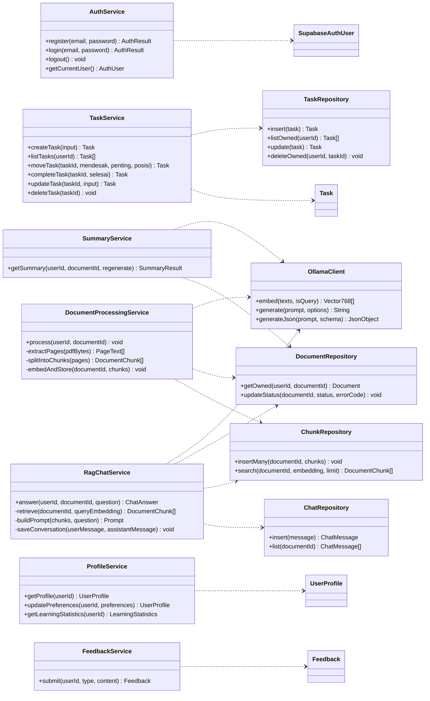

# LAPORAN TUGAS KELOMPOK

# ANALISIS DAN PERANCANGAN PERANGKAT LUNAK

# CLASS DIAGRAM APLIKASI PAHAMIN

Model kelas domain dan layanan, evaluasi kelengkapan dan kenormalan, serta kerangka kode

## Disusun oleh Kelompok INTERCORP

1. Andi Athallah Radja Maliq Muhammad — 103072400034
2. Krisna Putra Wicaksana — 103072400079
3. Calvin Immanuel Lado — 103072400158
4. Hierelda Talahatu — 103072400028

# PROGRAM STUDI S1 INFORMATIKA

# DIREKTORAT KAMPUS SURABAYA

# UNIVERSITAS TELKOM

**2026**

# DAFTAR ISI

1. [Tujuan dan ruang lingkup](#1-tujuan-dan-ruang-lingkup)
2. [Entitas dan tanggung jawab kelas](#2-entitas-dan-tanggung-jawab-kelas)
3. [Class diagram domain](#3-class-diagram-domain)
4. [Class diagram layanan](#4-class-diagram-layanan)
5. [Evaluasi kelengkapan class diagram](#5-evaluasi-kelengkapan-class-diagram)
6. [Evaluasi kenormalan model data](#6-evaluasi-kenormalan-model-data)
7. [Kerangka kode implementasi](#7-kerangka-kode-implementasi)
8. [Rencana integrasi login](#8-rencana-integrasi-login)
9. [Sumber acuan](#9-sumber-acuan)

---

# 1. Tujuan dan ruang lingkup

Laporan ini menyajikan class diagram PahaMIn berdasarkan model data dan rancangan layanan pada SKPL/DPPL v1.3. Tujuannya adalah memperlihatkan kelas yang dikelola aplikasi, relasi antarkelas, multiplicity, atribut beserta tipe dan visibility, serta operasi yang disediakan kelas.

PahaMIn membantu mahasiswa mengelola prioritas tugas dengan Matriks Eisenhower dan memahami materi PDF melalui Ruang Paham berbasis RAG. Model mengikuti enam entitas aplikasi yang telah dirancang. Identitas akun dimiliki Supabase Auth; kelas layanan autentikasi ditampilkan sebagai integrasi eksternal.

Dokumen ini juga menilai kelengkapan diagram dan normalisasi model relasional, serta menyediakan kerangka deklarasi kode tanpa isi logika method. Status repo dan langkah integrasi login dijelaskan sebagai rencana; laporan ini tidak mengimplementasikan atau menjalankan alur login.

## 1.1 Ruang lingkup dan notasi

Model mencakup identitas pengguna dari Supabase Auth, enam entitas data aplikasi, layanan autentikasi, tugas, dokumen, ringkasan, chat, profil, feedback, serta layanan backend RAG yang sudah dijelaskan DPPL. Kelas antarmuka seperti halaman login dan komponen UI tidak dimasukkan sebagai kelas domain karena merupakan komponen presentasi.

Notasi visibilitas UML:

- `+` publik: dapat dipanggil oleh lapisan lain melalui kontrak kelas.
- `-` privat: detail internal kelas, termasuk atribut domain.
- `#` terlindungi: untuk pewarisan bila diperlukan.
- `~` package: hanya untuk kelas dalam paket yang sama.

Tipe `UUID`, `DateTime`, `JsonObject`, dan `Vector768` adalah alias konseptual. Pada PostgreSQL, representasinya masing-masing `uuid`, `timestamptz`, `jsonb`, dan `vector(768)`.

## 1.2 Batas model

Diagram memisahkan kelas data domain dari kelas layanan dan tidak memasukkan halaman login atau komponen UI sebagai kelas domain. `auth.users` tetap diperlakukan sebagai layanan identitas eksternal, bukan tabel aplikasi.

# 2. Entitas dan tanggung jawab kelas

Enam kelas aplikasi bersesuaian dengan enam tabel pada ERD DPPL. Operasi kelas menjelaskan perilaku domain atau layanan; operasi tersebut tidak berarti setiap method harus menjadi kolom atau fungsi database.

| Kelas | Tanggung jawab | Persistensi |
|---|---|---|
| `SupabaseAuthUser` | Identitas dan email akun yang dikelola layanan autentikasi. | `auth.users` milik Supabase |
| `UserProfile` | Preferensi dan cache streak belajar per pengguna. | `profil_pengguna` |
| `Task` | Kartu tugas, klasifikasi Eisenhower, posisi, dan status selesai. | `tugas` |
| `Document` | Metadata PDF, status pemrosesan, dan ringkasan. | `dokumen` |
| `DocumentChunk` | Potongan teks, halaman sumber, dan embedding. | `potongan_dokumen` |
| `ChatMessage` | Pertanyaan/jawaban per dokumen, urutan, dan rujukan sumber. | `pesan_chat` |
| `Feedback` | Laporan bug atau masukan pengguna. | `umpan_balik` |

# 3. Class diagram domain


`SupabaseAuthUser` adalah kelas eksternal yang dikelola Supabase Auth, bukan tabel buatan aplikasi. Relasi profil ditulis `0..1` untuk mengakomodasi masa pembuatan/backfill profil; DPPL menetapkan trigger untuk membuat profil saat akun baru terdaftar. Tugas, dokumen, dan feedback mengikuti kepemilikan pengguna. Potongan dan pesan mengikuti siklus hidup dokumen, sesuai kebijakan cascade pada DPPL.

`SourceReference` adalah objek nilai yang disimpan dalam `pesan_chat.sumber` sebagai JSONB. Rujukan potongan tidak dimodelkan sebagai FK relasional langsung; validasi konsistensinya berada pada aturan database/layanan yang didokumentasikan DPPL.

# 4. Class diagram layanan

Diagram ini memperluas diagram layanan backend yang telah ada di DPPL dengan layanan web untuk alur tugas, profil, feedback, dan login. Ini adalah pembagian tanggung jawab logis, bukan klaim bahwa semua kelas layanan sudah tersedia dalam kode.



Operasi CRUD dokumen, profil, dan feedback dapat dipanggil dari Next.js ke Supabase sesuai DPPL. Pemrosesan PDF, embedding, ringkasan, dan RAG tetap melalui FastAPI. Validasi otorisasi pemilik harus dilakukan pada setiap layanan yang menangani data pengguna.

# 5. Evaluasi kelengkapan class diagram

| Aspek | Hasil evaluasi | Tindak lanjut |
|---|---|---|
| Cakupan objek domain | Lengkap untuk enam entitas persistensi PahaMIn v1.3 serta identitas Supabase Auth eksternal. | Pertahankan batas ini; jangan membuat kelas kuadran terpisah karena kuadran dihitung dari `mendesak` dan `penting`. |
| Atribut dan tipe | Atribut utama telah dipetakan dari kamus data DPPL; tipe UML diberi representasi yang sesuai dengan tipe SQL. | Pastikan perubahan schema tercermin di diagram dan kode. |
| Access modifier atribut | Atribut domain menggunakan `-` (private) agar perubahan dilakukan melalui operasi kelas. | Jangan membuka atribut langsung; validasi input pada service/API dan database. |
| Operasi dan access modifier | Operasi domain/service yang terlihat oleh pemanggil menggunakan `+`; operasi internal layanan menggunakan `-`. | Tambahkan operasi hanya ketika use case atau kebutuhan arsitektur membutuhkannya. |
| Relasi dan multiplicity | Relasi pemilik, dokumen-potongan, serta dokumen-pesan ditampilkan dengan jumlah objek. | Tinjau multiplicity profil bila semua akun lama sudah dijamin memiliki profil. |
| Relasi siklus hidup | Komposisi dipakai pada data turunan yang dihapus bersama pemilik/induk sesuai cascade dan keputusan retensi. | File Storage tetap memerlukan aksi penghapusan di service; komposisi database saja tidak menghapus objek Storage. |
| Enum dan nilai terbatas | Status dokumen, peran pesan, dan jenis feedback dimodelkan sebagai enumeration. | Samakan nilai enum aplikasi dengan constraint SQL dan payload API. |
| Batas lapisan | Kelas domain dipisahkan dari layanan dan repository; autentikasi eksternal diberi label. | Jangan mencampur komponen UI, ORM, dan entitas domain dalam satu kelas besar. |
| Fitur autentikasi | Alur login/register/logout tercakup melalui `AuthService`, tetapi belum merupakan bukti bahwa UI dan sesi telah berjalan. | Implementasikan dan verifikasi jalur UI–Supabase Auth–cookie/session–proteksi route. |

# 6. Evaluasi kenormalan model data

Evaluasi normalisasi pada bagian ini diterapkan terhadap skema relasional basis data yang dirancang dalam DPPL dan direalisasikan melalui SQL. Evaluasi tersebut meninjau struktur atribut dan relasi antartabel, sedangkan class diagram UML digunakan untuk menggambarkan struktur kelas, atribut, operasi, serta hubungan antarkelas.

## 6.1 Bentuk Normal Pertama (1NF)

Kolom biasa menyimpan nilai bertipe tunggal. Ada dua pengecualian semi-terstruktur yang disengaja: `profil_pengguna.preferensi` menyimpan sekumpulan preferensi dalam JSONB dan `pesan_chat.sumber` menyimpan daftar rujukan sumber dalam JSONB. Jika setiap preferensi atau rujukan perlu dicari, dihubungkan dengan FK, atau dikelola sebagai baris mandiri, pisahkan menjadi tabel anak. Untuk kebutuhan saat ini, JSONB mengurangi perubahan schema dan integritas rujukan sumber ditangani oleh validasi tambahan.

## 6.2 Bentuk Normal Kedua (2NF)

Setiap tabel menggunakan primary key satu kolom. Atribut non-key bergantung pada seluruh primary key, sehingga tidak tampak ketergantungan parsial. Constraint unik seperti `(dokumen_id, urutan)` mengatur identitas urutan tanpa mengubah PK utama.

## 6.3 Bentuk Normal Ketiga (3NF)

Data tugas, dokumen, potongan, chat, dan feedback dipisah menurut entitas sehingga tidak terlihat ketergantungan transitif umum di antara atribut non-key. `pesan_chat.user_id` mengulang pemilik yang dapat diturunkan dari `dokumen_id`; pasangan FK `(dokumen_id, user_id)` sengaja menjaga agar pesan hanya terkait dengan dokumen milik pengguna yang sama dan mempermudah kebijakan akses.

`profil_pengguna.streak_belajar` adalah cache yang dihitung dari aktivitas chat, dan `dokumen.ringkasan` adalah hasil turunan yang disimpan agar mudah ditampilkan kembali. Keduanya merupakan denormalisasi yang disengaja demi performa/kemudahan; pembaruannya harus tetap sinkron dengan sumber data. Kuadran tugas tidak disimpan sebagai kolom terpisah karena dapat dihitung dari `mendesak` dan `penting`, sehingga tidak ada duplikasi nilai kuadran.

## 6.4 Kesimpulan normalisasi

Model relasional inti secara umum memenuhi 2NF dan 3NF dengan beberapa pilihan semi-terstruktur atau cache yang disengaja. Untuk mendekati 1NF secara ketat dan menguatkan integritas referensial, opsi lanjutan adalah membuat tabel `preferensi_pengguna` dan `sumber_pesan`; perubahan tersebut tidak wajib selama JSONB tetap tervalidasi dan kebutuhan query tidak memerlukan relasi per item.

## 7. Kerangka kode implementasi

Kerangka ini menggambarkan model domain frontend. Method sengaja hanya berupa deklarasi abstrak agar kontrak dan visibility terlihat tanpa mengisi logika method. Alias waktu harus disamakan dengan bentuk serialisasi yang dipilih aplikasi.

```typescript
export type UUID = string;
export type DateTime = string;
export type JsonObject = Record<string, unknown>;
export type Vector768 = readonly number[];

export type DocumentStatus = "PENDING" | "PROCESSING" | "READY" | "FAILED";
export type ChatRole = "user" | "assistant";
export type FeedbackType = "bug" | "feedback";

export interface SourceReference {
  chunkId: UUID;
  halaman: number;
}

export abstract class UserProfile {
  constructor(
    private readonly userId: UUID,
    private streakBelajar: number,
    private preferensi: JsonObject,
    private readonly dibuatPada: DateTime,
    private diperbaruiPada: DateTime,
  ) {}

  abstract getUserId(): UUID;
  abstract getStreakBelajar(): number;
  abstract getPreferensi(): JsonObject;
  abstract updatePreferensi(preferensi: JsonObject): void;
  abstract updateStreak(streak: number): void;
}

export abstract class Task {
  constructor(
    private readonly taskId: UUID,
    private readonly userId: UUID,
    private judul: string,
    private mendesak: boolean,
    private penting: boolean,
    private selesai: boolean,
    private posisi: number,
    private readonly dibuatPada: DateTime,
    private diperbaruiPada: DateTime,
  ) {}

  abstract getTaskId(): UUID;
  abstract getJudul(): string;
  abstract isMendesak(): boolean;
  abstract isPenting(): boolean;
  abstract isSelesai(): boolean;
  abstract getPosisi(): number;
  abstract updateJudul(judul: string): void;
  abstract pindahKeKuadran(mendesak: boolean, penting: boolean, posisi: number): void;
  abstract tandaiSelesai(selesai: boolean): void;
}

export abstract class Document {
  constructor(
    private readonly documentId: UUID,
    private readonly userId: UUID,
    private readonly namaFile: string,
    private readonly lokasiFile: string,
    private readonly ukuranFile: number,
    private jumlahHalaman: number | null,
    private statusProses: DocumentStatus,
    private kodeError: string | null,
    private ringkasan: string | null,
    private ringkasanDibuatPada: DateTime | null,
    private diprosesPada: DateTime | null,
    private readonly dibuatPada: DateTime,
  ) {}

  abstract getDocumentId(): UUID;
  abstract getNamaFile(): string;
  abstract getStatusProses(): DocumentStatus;
  abstract getRingkasan(): string | null;
  abstract mulaiPemrosesan(waktu: DateTime): void;
  abstract tandaiSiap(jumlahHalaman: number, waktu: DateTime): void;
  abstract tandaiGagal(kodeError: string): void;
  abstract simpanRingkasan(ringkasan: string, waktu: DateTime): void;
}

export abstract class DocumentChunk {
  constructor(
    private readonly chunkId: UUID,
    private readonly documentId: UUID,
    private readonly urutan: number,
    private readonly halaman: number,
    private readonly isi: string,
    private readonly embedding: Vector768,
  ) {}

  abstract getChunkId(): UUID;
  abstract getHalaman(): number;
  abstract getIsi(): string;
  abstract getEmbedding(): Vector768;
}

export abstract class ChatMessage {
  constructor(
    private readonly messageId: UUID,
    private readonly documentId: UUID,
    private readonly userId: UUID,
    private readonly peran: ChatRole,
    private readonly isi: string,
    private readonly sumber: readonly SourceReference[] | null,
    private readonly urutan: number,
    private readonly dibuatPada: DateTime,
  ) {}

  abstract getMessageId(): UUID;
  abstract getPeran(): ChatRole;
  abstract getIsi(): string;
  abstract getSumber(): readonly SourceReference[] | null;
  abstract getUrutan(): number;
}

export abstract class Feedback {
  constructor(
    private readonly feedbackId: UUID,
    private readonly userId: UUID,
    private readonly jenis: FeedbackType,
    private readonly isi: string,
    private readonly dibuatPada: DateTime,
  ) {}

  abstract getFeedbackId(): UUID;
  abstract getJenis(): FeedbackType;
  abstract getIsi(): string;
}
```

Kelas domain dan signature di atas belum mengimplementasikan validasi, persistence, atau aturan bisnis. Implementasi kelak harus menggunakan pola validasi frontend proyek dan kontrak Supabase/FastAPI; tipe data dan aturan tabel tetap diverifikasi pada batas backend/database.

# 8. Rencana integrasi login

Status inspeksi repo saat penyusunan dokumen: halaman awal sudah menautkan `/login` dan `/register`; client Supabase browser/server serta `proxy.ts` tersedia. Berkas halaman login/register belum tampak pada struktur `web/app` yang diperiksa. `proxy.ts` memanggil `getUser()` untuk memperbarui sesi, tetapi belum mengarahkan pengguna tanpa sesi dari route terlindungi. Karena itu alur login belum dapat dianggap selesai hanya dari keberadaan client Supabase.

Tahapan agar alur IMK–kode–database tersambung:

1. **Cocokkan alur IMK/Figma.** Tetapkan field email/password, label, validasi, status loading, pesan gagal netral, aksi daftar akun, dan tujuan setelah login. Implementasi harus mengikuti ekspor Figma yang disetujui.
2. **Siapkan Supabase Auth.** Pastikan proyek Supabase tersedia dan metode email/password aktif. Konfigurasikan URL situs/redirect yang dipakai untuk localhost. Gunakan akun uji tanpa menaruh kredensial nyata di repo.
3. **Siapkan konfigurasi frontend.** Pastikan `NEXT_PUBLIC_SUPABASE_URL` dan `NEXT_PUBLIC_SUPABASE_ANON_KEY` tersedia di `web/.env.local`, lalu restart server web. Nilai ini dipakai client Supabase; jangan pernah memasukkan service role key ke browser.
4. **Bangun halaman login dan register.** Buat route yang dituju tautan landing page. Gunakan form `react-hook-form`, schema Zod, `zodResolver`, dan client Supabase browser. Login email/password memanggil `signInWithPassword`; pendaftaran memanggil `signUp` sesuai konfigurasi Auth.
5. **Pastikan sesi server.** Pertahankan cookie sesi melalui Supabase SSR. Gunakan `getUser()` untuk identitas yang diverifikasi pada server. Tambahkan proteksi route untuk halaman privat dan pengalihan yang konsisten untuk sesi valid/tidak valid.
6. **Hubungkan identitas ke database.** Identitas `auth.users.id` menjadi `user_id` pada tabel aplikasi. Pastikan trigger pembuatan `profil_pengguna` dan kebijakan RLS berbasis `auth.uid()` berjalan. Login sukses tidak boleh memberi akses ke baris pengguna lain.
7. **Selesaikan keluar dan pesan UI.** Aksi logout memanggil `signOut`, membersihkan cookie sesi, lalu mengarahkan ke halaman publik. Pesan gagal login harus netral dan tidak mengungkap apakah email terdaftar.
8. **Verifikasi alur ujung ke ujung.** Periksa register/login valid, kata sandi salah, input tidak valid, refresh halaman setelah login, akses langsung route terlindungi, logout, sesi kedaluwarsa, serta isolasi data dua akun.

Langkah di atas hanya penjelasan rencana. Tidak ada halaman login, konfigurasi Supabase, database, atau kode aplikasi yang diubah atau dijalankan sebagai bagian dari pembuatan dokumen ini.

# 9. Sumber acuan

- `docs/DPPL_PahaMIn_INTERCORP_v1.3.md`: diagram layanan, ERD, kamus data, aturan autentikasi, RLS, serta pembagian tanggung jawab frontend/backend.
- `docs/SKPL_PahaMIn_INTERCORP_v1.3.md`: aktor, use case login, kebutuhan fitur, dan aturan domain.
- `docs/panduan/.cursorrules`: standar arsitektur PahaMIn yang menjadi batas implementasi.
